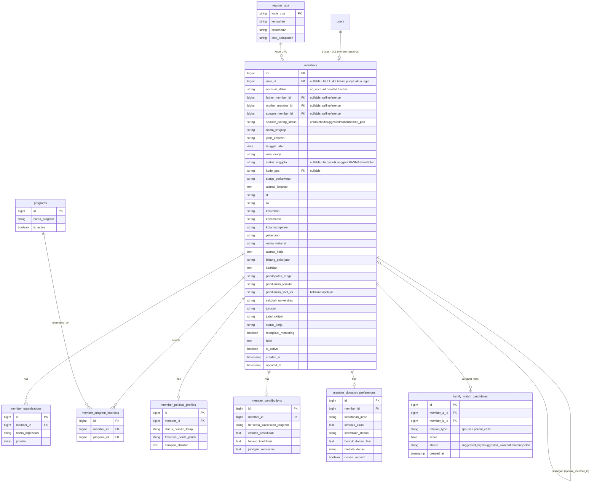

# Product Requirements Document (PRD)
## Ngopipanmas — Sistem Informasi Anggota PANMAS

| | |
|---|---|
| **Versi Dokumen** | 1.0 |
| **Tanggal** | 12 Juni 2026 |
| **Status** | Draft untuk Review |
| **Tech Stack** | PHP 8.x, CodeIgniter 4, MySQL 8, CodeIgniter Shield (Auth) |

---

## 1. Ringkasan Eksekutif

**Ngopipanmas** adalah aplikasi web berbasis data untuk mengelola database anggota komunitas PANMAS (Pembinaan Anggota Masyarakat). Saat ini data anggota dikumpulkan melalui Google Form/Excel ("KUESIONER ANGGOTA PKS PANMAS") yang berisi ±295 baris data dengan ±189 kolom, mencakup data diri, data pasangan, data hingga 10 anak, pekerjaan, pendidikan, keaktifan organisasi, partisipasi politik, kesediaan kontribusi/donasi, dan preferensi iuran.

Ngopipanmas akan menggantikan proses manual ini dengan:
- Database terpusat & terstruktur (MySQL) hasil migrasi dari data Excel yang ada.
- Login berbasis **CodeIgniter Shield** untuk Admin dan Anggota.
- Anggota dapat login dan **memperbarui data pribadi & keluarganya sendiri**.
- Admin dapat mengelola seluruh data anggota, melihat statistik/laporan, dan mengelola modul program kerja & donasi/iuran.
- Dashboard & laporan agregat (demografi, peta UPA, partisipasi program, kesediaan donasi, dll) untuk mendukung pengambilan keputusan struktur.

---

## 2. Latar Belakang

1. Data anggota saat ini tersebar dalam bentuk hasil Google Form (Excel), sulit dicari, sulit diperbarui, dan rawan duplikasi/inkonsistensi (contoh: variasi penulisan "Insya Allah", "InsyaAllah", "Insyaallah" pada kolom isian bebas).
2. Tidak ada mekanisme bagi anggota untuk memperbarui data sendiri ketika terjadi perubahan (pindah alamat, anak baru lahir, ganti pekerjaan, dll).
3. Struktur PANMAS membutuhkan data terstruktur untuk perencanaan program kerja, pemetaan potensi donasi/iuran, dan pemetaan keaktifan politik anggota (status pemilih, sumber informasi, dll) per wilayah (Kode UPA).

---

## 3. Tujuan (Goals)

1. Menyediakan basis data anggota terpusat, terstruktur, dan dapat diaudit.
2. Memungkinkan anggota memperbarui profil diri, pasangan, dan data anak (hingga 10 anak) secara mandiri (self-service).
3. Memungkinkan Admin melakukan CRUD penuh terhadap data anggota, master data wilayah (UPA), dan master data program kerja.
4. Menyediakan modul **Program Kerja & Partisipasi** untuk mencatat minat program, kesediaan kontribusi, dan jaringan/komunitas anggota.
5. Menyediakan modul **Iuran & Donasi** untuk mencatat kepatuhan iuran rutin, kesediaan donasi, preferensi metode, dan preferensi anonimitas.
6. Menyediakan dashboard & laporan ringkas (statistik demografi, distribusi per UPA, partisipasi program, status iuran) untuk Admin.
7. Migrasi satu kali (one-time migration) seluruh data dari file Excel kuesioner ke database MySQL.
8. Menyediakan **Katalog Produk Anggota** (direktori UMKM) untuk mendukung pemberdayaan ekonomi sesama anggota.
9. Menyediakan **CMS Artikel & Berita** untuk publikasi konten dakwah/edukasi dan informasi kegiatan struktur.
10. Menyediakan **Modul Event/Kegiatan** dengan pendaftaran/RSVP & presensi peserta.
11. Menyediakan **Galeri Anggota Berprestasi** untuk apresiasi pencapaian anggota.
12. Menyediakan **Mutaba'ah Yaumiyah** sebagai sarana self-monitoring ibadah harian anggota, dengan privasi data individu terjaga.

### Non-Goals (Di Luar Lingkup v1)
- Sinkronisasi otomatis/berkelanjutan dengan Google Form (hanya import satu kali di awal).
- Modul pembayaran/payment gateway aktual (sistem hanya mencatat **preferensi & status**, bukan memproses transaksi) — termasuk Katalog Produk yang bersifat direktori saja, bukan e-commerce (tanpa keranjang/checkout).
- Aplikasi mobile native (fokus web responsif).
- Role berjenjang per-UPA (Pengurus UPA) — dicatat sebagai potensi *fase 2* (lihat Roadmap).
- Notifikasi WhatsApp/SMS otomatis (fase 2/3) — termasuk pengingat Mutaba'ah Yaumiyah.
- Fitur sosial lanjutan (komentar, like, share antar-anggota di Artikel/Event/Katalog) — v1 berfokus pada publikasi & direktori satu arah; interaksi sosial dicatat sebagai potensi fase lanjutan.

---

## 4. Target Pengguna & Roles

| Role | Deskripsi | Akses Utama |
|---|---|---|
| **Super Admin** | Pengurus inti / pengelola sistem | Akses penuh: kelola anggota, user, role, master data, laporan, konfigurasi |
| **Admin** | Pengurus struktur yang ditugaskan input/verifikasi data | CRUD data anggota, lihat laporan, kelola program kerja |
| **Anggota** | Anggota terdaftar PANMAS (Dewasa/Madya/Utama) | Login, lihat & edit profil sendiri (data diri, pasangan, anak), isi/ubah preferensi program & donasi sendiri |

> Catatan: Setiap **Anggota** memiliki tepat satu akun `user` (Shield) yang terhubung 1:1 ke satu record `members`. Akun dibuatkan oleh Admin saat proses migrasi/registrasi awal (email/No. HP sebagai username, password default yang wajib diganti saat login pertama), atau anggota dapat melakukan registrasi mandiri dengan verifikasi Admin (lihat 8.1).
>
> **Permission tambahan (opsional, via Shield Groups/Permissions):** Admin dapat memberikan permission **"Kontributor"** kepada Anggota tertentu agar dapat menulis Artikel/Berita (7.11) — konten yang ditulis Kontributor tetap memerlukan approval Admin sebelum `Published`. Permission ini tidak menambah role baru, hanya permission tambahan di atas role **Anggota**.

---

## 5. Ringkasan Sumber Data (Excel Kuesioner)

File sumber: `KUESIONER_ANGGOTA_PKS_PANMAS__Jawaban_.xlsx` (sheet `Form Responses 1`, 295 baris data + header, 189 kolom).

Kelompok data utama dalam kuesioner:

| Kelompok | Contoh Kolom | Catatan |
|---|---|---|
| **Identitas & Keanggotaan** | Nama lengkap, Usia, Status Anggota (Dewasa/Madya/Utama), Kode UPA, Status perkawinan | Status Anggota & Kode UPA jadi atribut inti keanggotaan |
| **Alamat** | Alamat lengkap, RT, RW, Kelurahan, Kecamatan, Kota/Kabupaten | Kode UPA berkorelasi dengan wilayah (53 kode unik ditemukan) |
| **Pekerjaan & Ekonomi** | Pekerjaan, Nama Instansi, Bidang pekerjaan, Pendapatan (range), Pekerjaan & pendapatan pasangan, Keahlian | Pendapatan disimpan sebagai kategori (5 range tetap) |
| **Pendidikan** | Pendidikan terakhir (SMP–S2/S3) | Kategori tetap (5 nilai) |
| **Data Anak (1–10)** | Nama, Jenis kelamin, Tgl lahir, Status pernikahan, Pendidikan saat ini, Mentoring, Sekolah/Univ, Jurusan, Judul skripsi, Hobi, Keahlian, Status kerja | Pola berulang per anak (≈ 12-13 kolom × 10 anak) → setiap anak menjadi record `members` tersendiri (shadow profile), ditautkan via `father_member_id`/`mother_member_id` (lihat 9.0 & 11.1) |
| **Organisasi** | Aktif organisasi (Ya/Tidak), Nama organisasi & jabatan (free text "Org1: ketua, Org2: anggota") | Akan dinormalisasi ke `member_organizations` |
| **Politik & Partisipasi** | Status pemilih tetap, Frekuensi ikuti berita politik, Sumber info politik, Program utama yang diinginkan (multi-select), Harapan ke struktur | `member_political_profile` + `member_program_interests` |
| **Kontribusi** | Kesediaan sukseskan program, Bidang kontribusi, Jaringan/komunitas yang dimiliki | `member_contributions` |
| **Iuran & Donasi** | Kesediaan donasi, Bentuk donasi lain, Kepatuhan iuran rutin, Metode donasi, Anonimitas donasi, Kendala bayar iuran | `member_donation_preferences` |

> Mapping kolom Excel → tabel/kolom DB lengkap akan dibuat sebagai **dokumen lampiran terpisah** (`data-mapping.xlsx` / sheet mapping) sebelum pengembangan migrasi dimulai (lihat 11. Migrasi Data).

---

## 6. Tech Stack & Arsitektur

| Layer | Teknologi |
|---|---|
| Bahasa & Framework | PHP 8.1+, CodeIgniter 4 (terbaru, MVC) |
| Autentikasi & Otorisasi | CodeIgniter Shield (Auth, Groups, Permissions) |
| Database | MySQL 8.x |
| Frontend | Server-rendered Views (CI4) + Bootstrap 5 / Tailwind (pilih salah satu saat sprint 0), Vanilla JS / Alpine.js untuk interaktivitas ringan |
| Templating | CI4 View + Layout (parser/native PHP views) |
| Export Laporan | PhpSpreadsheet (export Excel), Dompdf (export PDF) |
| Import Data Awal | CLI Seeder/Command (`php spark migrate:legacy-data`) memanfaatkan PhpSpreadsheet |
| Hosting (asumsi) | Shared/VPS Linux, Apache/Nginx + PHP-FPM |

### 6.1 Arsitektur Tingkat Tinggi

```
[Browser]
   |
   v
[CodeIgniter 4 App]
   ├─ Auth Layer (Shield: Login, Register, Reset Password, Groups/Permissions)
   ├─ Controllers: Admin\*, Member\*, Auth\*, Report\*, Catalog\*, Article\*, Event\*, Achievement\*, Mutabaah\*
   ├─ Models: Member, Organization, Program, Donation, Region(UPA),
   │          Product, Article, Event, EventRegistration, Achievement, MutabaahItem, MutabaahLog
   ├─ Services: ImportService, ReportService, ProfileService, MatchingService
   └─ Views: admin/*, member/*, auth/*, public/* (katalog, artikel/berita, event, anggota berprestasi)
   |
   v
[MySQL Database]
   ├─ users, auth_groups, auth_permissions (Shield)
   ├─ members (unified person model), member_organizations
   ├─ programs, member_program_interests
   ├─ member_political_profiles, member_contributions, member_donation_preferences
   ├─ regions_upa (master Kode UPA / wilayah), family_match_candidates
   └─ member_products, articles, events, event_registrations,
      member_achievements, mutabaah_items, mutabaah_logs (modul konten & komunitas, 9.3)
```

---

## 7. Modul & Fitur Detail

### 7.1 Modul Autentikasi (CodeIgniter Shield)

| Fitur | Deskripsi | Role |
|---|---|---|
| Login | Login dengan email/username + password | Semua |
| Registrasi Anggota | Form registrasi mandiri (data minimal: nama, email/no HP, password) → status `pending`, menunggu verifikasi Admin yang akan menautkan ke data `members` (hasil migrasi) atau membuat record baru | Anggota (calon) |
| Verifikasi & Approval | Admin meninjau registrasi baru, menautkan ke record anggota (jika sudah ada dari migrasi) atau membuat record baru, lalu mengaktifkan akun | Admin |
| Lupa Password / Reset | Reset via email | Semua |
| Force Password Change | Wajib ganti password saat login pertama (untuk akun hasil migrasi dengan password default) | Anggota |
| Manajemen Role/Group | CRUD Group (Super Admin, Admin, Anggota) & Permission via Shield | Super Admin |
| Manajemen User | Aktif/nonaktifkan akun, reset password user lain, lihat log login | Super Admin, Admin |

### 7.2 Modul Profil Anggota (Self-Service)

| Fitur | Deskripsi |
|---|---|
| Lihat Profil | Anggota melihat seluruh data dirinya (read-only sebagian field terkunci, mis. Kode UPA hanya diubah Admin) |
| Edit Data Diri | Nama, usia (rentang), status perkawinan, alamat lengkap (alamat, RT, RW, Kelurahan, Kecamatan, Kota/Kab), pekerjaan, instansi, bidang pekerjaan, pendapatan (range), pendidikan terakhir, keahlian |
| Edit Data Pasangan | Nama pasangan, pekerjaan pasangan, pendapatan pasangan (range) — muncul jika `status_perkawinan = Menikah` |
| Kelola Data Keluarga (Anak) | Tambah/edit anak: nama, jenis kelamin, tgl lahir, status pernikahan, pendidikan saat ini, mentoring, sekolah/universitas, jurusan, judul skripsi, status kerja, pekerjaan, hobi, keahlian. Setiap anak adalah record `members` tersendiri (`father_member_id`/`mother_member_id` menunjuk ke ortu, `account_status = no_account` jika belum punya akun) — lihat 9.0 & 11.1. Jika pasangan (`spouse_member_id`) sudah `confirmed`, penambahan anak baru otomatis mengisi `father_member_id` & `mother_member_id` sekaligus (11.1.5), sehingga anak hanya perlu diinput sekali oleh ortu manapun. Jika anak sudah punya akun sendiri (`account_status = active`), field identitas (nama, jenis kelamin, tgl lahir, alamat) tampil **read-only** di sisi ortu, ditarik langsung dari profil anak |
| Ajukan Akun untuk Anak | Anggota dapat mengajukan agar record anak (shadow profile, `account_status = no_account`) dibuatkan akun login sendiri (mis. anak sudah dewasa) → Admin menindaklanjuti via "Tinjau Data Anak" untuk mengundang/membuat akun (`account_status: no_account → invited → active`) |
| Riwayat Perubahan | Anggota dapat melihat riwayat perubahan data dirinya (audit log sederhana) |
| Histori perubahan untuk Admin | Admin dapat melihat siapa & kapan field tertentu diubah |

### 7.3 Modul Organisasi & Keaktifan

| Fitur | Deskripsi |
|---|---|
| Status Keaktifan Organisasi | Toggle "Aktif dalam organisasi masyarakat/keagamaan" (Ya/Tidak) |
| Daftar Organisasi & Jabatan | Anggota dapat menambahkan ≥1 entri: nama organisasi + jabatan/peran (dropdown jabatan: Ketua, Pengurus, Anggota, Lainnya), menggantikan format teks bebas "Organisasi 1: ketua, Organisasi 2: anggota" |

### 7.4 Modul Politik & Partisipasi

| Fitur | Deskripsi |
|---|---|
| Status Pemilih Tetap | Ya/Tidak/Belum tahu |
| Frekuensi Mengikuti Berita Politik | Selalu / Kadang-kadang / Jarang / Tidak pernah |
| Sumber Informasi Politik | Multi-select (Media Sosial, Media Online, Surat Kabar, Obrolan/Keluarga-Teman, TV, Lainnya — *free text* dirapikan jadi master kategori + opsi "Lainnya") |
| Minat Program Kerja | Multi-select maksimal 3 dari master data **Program** (mis. Ekonomi & Lapangan Kerja, Pendidikan, Kesehatan, Sosial-Keagamaan, dll), dikelola Admin |
| Harapan kepada Struktur | Free text |

### 7.5 Modul Kontribusi & Kesediaan

| Fitur | Deskripsi |
|---|---|
| Kesediaan Menyukseskan Program | Ya / Tidak / Bersyarat (dengan catatan, mis. terkait pekerjaan suami ASN — disimpan sebagai catatan teks) |
| Bidang Kontribusi | Multi-select (mis. tenaga, pemikiran/ide, jaringan, finansial, dll — master data dikelola Admin) |
| Jaringan/Komunitas | Daftar jaringan/komunitas yang dimiliki anggota, input sebagai list terpisah (bukan satu string dipisah koma) |

### 7.6 Modul Iuran & Donasi

| Fitur | Deskripsi |
|---|---|
| Kepatuhan Iuran Rutin | Selalu / Kadang / Tidak pernah / Sesuai kebutuhan kampanye |
| Kendala Membayar Iuran | Free text (opsional) |
| Kesediaan Donasi Tambahan | Ya / Tidak / Mungkin |
| Bentuk Donasi Lain | Free text / multi-select (barang, jasa, tenaga, dll) |
| Preferensi Metode Donasi | Transfer Bank, E-wallet, Tunai, Lainnya |
| Preferensi Anonimitas | Ya/Tidak — jika Ya, nama anggota disembunyikan dari laporan donasi yang dipublikasikan |

### 7.7 Modul Manajemen Data Master (Admin)

| Master Data | Deskripsi |
|---|---|
| Wilayah / Kode UPA | CRUD Kode UPA beserta Kelurahan/Kecamatan/Kota terkait (53 kode unik dari data awal) |
| Program Kerja | CRUD daftar program kerja yang bisa dipilih anggota |
| Bidang Kontribusi | CRUD daftar bidang kontribusi |
| Kategori Pekerjaan/Bidang Pekerjaan | CRUD daftar standar (untuk normalisasi data pekerjaan yang saat ini sangat beragam) |
| Sumber Informasi Politik | CRUD daftar sumber informasi |
| Kategori Produk | CRUD kategori produk/jasa untuk Katalog Produk Anggota (7.10) |
| Kategori Artikel/Berita | CRUD kategori untuk Artikel & Berita (7.11), dengan tipe (Artikel/Berita) |
| Item Mutaba'ah Yaumiyah | CRUD daftar item ibadah yang dipantau, tipe input, urutan, status aktif (7.14) |

### 7.8 Modul Manajemen Anggota (Admin)

| Fitur | Deskripsi |
|---|---|
| Daftar Anggota | Tabel anggota dengan pencarian, filter (Kode UPA, Status Anggota, Status Perkawinan, Kecamatan, dll), pagination |
| Detail Anggota | Tampilan lengkap seluruh data (semua tab/section sesuai modul 7.2–7.6) |
| CRUD Anggota | Tambah/ubah/nonaktifkan (soft delete) data anggota |
| Kelola Akun Terkait | Buat/tautkan akun login untuk anggota, reset password |
| Export Data | Export daftar anggota (filtered) ke Excel/PDF |
| Tinjau & Tautkan Pasangan | Halaman untuk meninjau kandidat relasi pasangan (`family_match_candidates`, `relation_type=spouse`, lihat 11.1.2), konfirmasi/tolak tautan `spouse_member_id`, atau cari manual |
| Tinjau Data Anak | Halaman untuk meninjau kandidat shadow profile anak hasil dedup ayah-ibu (`family_match_candidates`, `relation_type=parent_child`, lihat 11.1.3), konfirmasi penggabungan/pemisahan, dan mengundang anak (shadow profile) untuk membuat akun sendiri (`account_status: no_account → invited → active`) |

### 7.9 Modul Dashboard & Laporan (Admin)

| Laporan | Deskripsi |
|---|---|
| Statistik Demografi | Total anggota per Status Anggota (Dewasa/Madya/Utama), per rentang usia, per status perkawinan, per pendidikan terakhir |
| Distribusi Wilayah | Jumlah anggota per Kode UPA / Kecamatan / Kelurahan (tabel + grafik) |
| Statistik Ekonomi | Distribusi rentang pendapatan anggota & pasangan |
| Partisipasi Politik | % terdaftar pemilih, distribusi frekuensi ikuti berita, sumber info politik |
| Minat Program | Ranking program kerja paling diminati |
| Kesediaan Donasi & Iuran | Distribusi kesediaan donasi, kepatuhan iuran, preferensi metode |
| Data Anak | Statistik jumlah anak per keluarga, distribusi jenjang pendidikan anak, jumlah anak yang sudah bekerja |

> ⚠️ Untuk laporan berbasis "keluarga/rumah tangga" (mis. total pendapatan rumah tangga, jumlah anak per keluarga), sistem **wajib menghitung satu kali per pasangan yang sudah `spouse_pairing_status = confirmed`** (gunakan `MIN(id, spouse_member_id)` sebagai representative ID) agar tidak terjadi duplikasi penghitungan — lihat 11.1.4.

### 7.10 Modul Katalog Produk Anggota (UMKM)

Direktori produk/jasa UMKM milik anggota, untuk saling mempromosikan usaha antar-sesama anggota PANMAS.

| Fitur | Deskripsi | Role |
|---|---|---|
| Tambah/Kelola Produk | Anggota menambahkan produk/jasa miliknya: nama produk, kategori (master, lihat 7.7), deskripsi, harga (opsional/"Hubungi penjual"), foto (1-5 gambar), kontak (WhatsApp), link marketplace eksternal (Shopee/Tokopedia/Instagram, opsional), status (Aktif/Nonaktif) | Anggota |
| Moderasi Produk | Admin meninjau produk baru (`status: pending → published/rejected`) sebelum tampil di katalog publik, untuk mencegah konten tidak pantas/spam | Admin |
| Katalog/Direktori Produk | Halaman publik & dashboard anggota: daftar produk dengan pencarian & filter (kategori, Kode UPA/wilayah penjual), tampilan grid dengan foto, harga, dan tombol "Hubungi via WhatsApp" (membuka chat WA dengan nomor penjual) | Semua (publik), Anggota, Admin |
| Detail Produk | Halaman detail produk: galeri foto, deskripsi lengkap, info penjual (nama, link profil, wilayah), produk lain dari penjual yang sama | Semua |

> Sesuai *Non-Goals* (Bab 3): modul ini **murni katalog/direktori**, tidak ada keranjang belanja, checkout, atau pemrosesan pembayaran di sistem — transaksi dilanjutkan secara langsung antara pembeli & penjual via WhatsApp/link eksternal.

### 7.11 Modul Artikel & Berita (CMS)

Modul konten untuk publikasi artikel (edukasi/opini/dakwah) dan berita (kegiatan/pengumuman struktur).

| Fitur | Deskripsi | Role |
|---|---|---|
| Tulis & Kelola Konten | Buat/edit/hapus artikel atau berita: judul, slug (auto-generate, dapat diedit), tipe (Artikel/Berita), kategori (master, dikelola di 7.7), konten (rich text editor + gambar), foto sampul, status (Draft/Published/Archived), tanggal publikasi | Admin (dan Anggota dengan permission "Kontributor" jika diberikan Admin — lihat 9.0 perluasan role via Shield Groups) |
| Approval Konten Kontributor | Jika ditulis oleh Anggota berstatus Kontributor, konten masuk status `Draft`/`Pending Review` dan harus disetujui Admin sebelum `Published` | Admin |
| Daftar & Baca Artikel/Berita | Halaman publik & dashboard: listing artikel/berita published (terbaru, per kategori, pencarian judul), halaman baca lengkap dengan penghitung jumlah dibaca (`views_count`) | Semua |
| Artikel/Berita Terkait | Pada halaman baca, tampilkan rekomendasi artikel/berita lain dari kategori yang sama | Semua |

### 7.12 Modul Event / Kegiatan

Modul agenda & pendaftaran kegiatan PANMAS (kajian, bakti sosial, rapat akbar, dll).

| Fitur | Deskripsi | Role |
|---|---|---|
| Buat & Kelola Event | Admin membuat event: judul, deskripsi, lokasi (teks/alamat, opsional link maps), tanggal & jam mulai-selesai, kuota peserta (opsional), poster/flyer, status (Draft/Published/Selesai/Dibatalkan) | Admin |
| Daftar Event (Publik & Anggota) | Halaman publik & dashboard: listing event mendatang & lampau (kalender/list), filter per status & wilayah/UPA penyelenggara | Semua |
| Pendaftaran/RSVP | Anggota mendaftar ke event (jika `status=Published` dan kuota belum penuh) → tercatat di `event_registrations`, anggota dapat membatalkan pendaftaran sebelum event berlangsung | Anggota |
| Kelola Peserta & Presensi | Admin melihat daftar peserta terdaftar per event, dapat menandai kehadiran (Hadir/Tidak Hadir) — data presensi dapat digunakan untuk laporan partisipasi anggota | Admin |

### 7.13 Modul Anggota Berprestasi

Showcase pencapaian/prestasi anggota untuk apresiasi & motivasi komunitas.

| Fitur | Deskripsi | Role |
|---|---|---|
| Tambah Prestasi Anggota | Admin menambahkan entri prestasi untuk seorang anggota: judul prestasi, deskripsi, tanggal pencapaian, foto/dokumentasi pendukung | Admin |
| Tandai sebagai "Featured" | Admin menandai prestasi tertentu sebagai *featured* untuk periode tertentu (mis. "Anggota Berprestasi Bulan Ini") — ditampilkan menonjol di halaman beranda/dashboard | Admin |
| Galeri/Daftar Anggota Berprestasi | Halaman publik & dashboard menampilkan daftar anggota berprestasi (featured saat ini + arsip per periode), tiap entri menampilkan foto anggota, judul prestasi, dan ringkasan | Semua |
| Riwayat Prestasi per Anggota | Pada halaman profil anggota (dapat dilihat publik/anggota lain sesuai pengaturan privasi), ditampilkan riwayat prestasi anggota tersebut | Semua |

### 7.14 Modul Mutaba'ah Yaumiyah

Lembar kontrol ibadah harian (self-monitoring) untuk mendukung pembinaan anggota — privasi data ibadah individu dijaga ketat (lihat catatan privasi di bawah).

| Fitur | Deskripsi | Role |
|---|---|---|
| Master Item Mutaba'ah | Admin mengelola daftar item yang dipantau (mis. Shalat Subuh/Dzuhur/Ashar/Maghrib/Isya berjamaah, Tilawah Al-Qur'an, Qiyamul Lail, Shaum Sunnah, Dzikir Pagi-Petang, Sedekah, Olahraga, dll), termasuk tipe input (Ya/Tidak, jumlah halaman/ayat, skala), urutan tampil, dan status aktif | Admin |
| Isi Mutaba'ah Harian | Anggota mengisi checklist/log harian sesuai item master yang aktif (idealnya diisi tiap hari, dapat juga diisi mundur untuk hari-hari sebelumnya dalam rentang terbatas, mis. 7 hari terakhir) + catatan opsional | Anggota |
| Rekap & Grafik Pribadi | Anggota melihat rekap mingguan/bulanan miliknya sendiri: persentase konsistensi per item, grafik tren, untuk evaluasi diri | Anggota |
| Rekap Agregat (Admin) | Admin/pembina melihat **rekap agregat** (rata-rata tingkat partisipasi per item, per UPA, per periode) — **tanpa** menampilkan detail isian harian tiap individu, untuk menjaga privasi | Admin |
| Pengingat (opsional, fase lanjutan) | Notifikasi pengingat pengisian harian — termasuk dalam *Potensi Fase Lanjutan* (Bab 12), karena bergantung pada modul notifikasi WA/Email yang belum masuk v1 | - |

> ⚠️ **Privasi:** detail isian Mutaba'ah Yaumiyah per anggota (per hari, per item) hanya dapat diakses oleh **anggota ybs sendiri**. Admin/pembina hanya melihat agregat statistik (rata-rata, persentase), kecuali jika ada mekanisme "berbagi dengan pembina" yang **secara eksplisit diaktifkan oleh anggota ybs** (opt-in, di luar lingkup v1 — dicatat sebagai potensi fase lanjutan).

---

## 8. Alur Pengguna Utama (User Flows)

### 8.1 Registrasi & Aktivasi Akun Anggota
1. Admin melakukan **migrasi awal** seluruh data Excel ke tabel `members` (tanpa akun login).
2. Admin meng-generate undangan/akun untuk setiap anggota (email/No. HP sebagai username + password sementara), **atau**
3. Anggota baru melakukan **registrasi mandiri** → mengisi nama & kontak → status `pending_verification`.
4. Admin mencocokkan/menautkan registrasi ke record `members` yang sesuai (atau membuat baru jika benar-benar anggota baru) → akun `active`.
5. Anggota login pertama kali → wajib ganti password → diarahkan ke halaman "Lengkapi/Periksa Profil Anda".

### 8.2 Anggota Memperbarui Profil
1. Login → Dashboard Anggota.
2. Buka tab "Profil Saya" → edit data diri/pasangan.
3. Buka tab "Data Anak" → tambah/ubah/hapus data anak.
4. Buka tab "Organisasi", "Politik & Program", "Iuran & Donasi" → update preferensi.
5. Setiap simpan → tercatat di audit log (siapa, kapan, field apa yang berubah).

### 8.3 Admin Mengelola Data
1. Login sebagai Admin → Dashboard Admin (ringkasan statistik).
2. Menu "Anggota" → cari/filter → lihat detail / edit / nonaktifkan.
3. Menu "Master Data" → kelola Wilayah (UPA), Program Kerja, dll.
4. Menu "Laporan" → pilih jenis laporan & filter → lihat grafik/tabel → export Excel/PDF.

---

## 9. Skema Data (Ringkasan Tabel)



> Tabel Shield (`users`, `auth_identities`, `auth_groups_users`, `auth_groups`, `auth_permissions`, dll) menggunakan struktur bawaan CodeIgniter Shield dan tidak diubah strukturnya, hanya ditautkan via `members.user_id` (nullable — lihat 9.0).

### 9.0 Satu Tabel `members` untuk Semua Orang (Unified Person Model)

**Keputusan desain kunci:** tidak ada tabel `member_children` terpisah. Setiap orang yang muncul di data — baik anggota PANMAS yang mengisi kuesioner, pasangan mereka, maupun anak-anak mereka (termasuk yang masih di bawah umur dan belum punya akun) — disimpan sebagai **satu record di tabel `members`**. Ini karena semua entity tersebut secara konsep adalah hal yang sama: **Person**, yang *mungkin* juga seorang pengguna terdaftar (punya akun login) dan/atau anggota resmi PANMAS.

- **`user_id` nullable** — diisi hanya jika orang tersebut punya akun login Shield. `account_status`: `no_account` (belum punya akun — disebut **shadow profile**), `invited` (sudah diundang/dibuatkan akun tapi belum aktivasi), `active` (sudah login & mengelola profilnya sendiri).
- **`status_anggota` nullable** — hanya diisi (`Dewasa`/`Madya`/`Utama`) untuk orang yang benar-benar terdaftar sebagai anggota PANMAS. Shadow profile anak kecil, misalnya, `status_anggota = NULL`.
- **Relasi keluarga via self-reference:**
  - `father_member_id` / `mother_member_id` — relasi **vertikal** (antar generasi), tidak terbatas kedalaman (anak bisa punya anak lagi, dst).
  - `spouse_member_id` + `spouse_pairing_status` — relasi **horizontal** (pasangan suami-istri), bidirectional.
- **Field "anak/pelajar"** (`pendidikan_saat_ini`, `sekolah_universitas`, `jurusan`, `judul_skripsi`, `status_kerja`, `mengikuti_mentoring`) bersifat nullable dan relevan untuk siapa pun yang masih berstatus pelajar — baik shadow profile anak, maupun anggota dewasa yang masih kuliah.
- **`urutan_anak` tidak disimpan sebagai kolom** — urutan anak (jika perlu ditampilkan) diturunkan dari `ORDER BY tanggal_lahir` terhadap anak-anak dari `father_member_id`/`mother_member_id` yang sama.
- **`family_match_candidates`** — tabel kerja untuk menampung hasil pencocokan otomatis (spouse maupun parent-child) yang menunggu/sudah ditinjau Admin. Dipakai saat migrasi awal **dan** selama operasional (lihat 11.1 & 11.2).


### 9.1 Tabel Pendukung Multi-Select (Many-to-Many)
- `member_information_sources` (sumber informasi politik, many-to-many ke `information_sources` master) — alternatif jika sumber info politik dibuat multi-select.
- `member_contribution_areas` (bidang kontribusi, many-to-many ke `contribution_areas` master).
- `member_networks` (jaringan/komunitas, one-to-many free text per anggota).

### 9.2 Audit Log
- `activity_logs`: `id, user_id, member_id, table_name, record_id, field_name, old_value, new_value, action, created_at` — mencatat perubahan data anggota (oleh anggota sendiri maupun Admin).

### 9.3 Tabel Modul Konten & Komunitas (7.10–7.14)

```
product_categories      { id PK, nama_kategori, is_active }
member_products         { id PK, member_id FK -> members, kategori_id FK -> product_categories,
                           nama_produk, deskripsi, harga, satuan, foto_urls (JSON),
                           kontak_whatsapp, link_eksternal, status "pending/published/rejected/nonaktif",
                           created_at, updated_at }

article_categories      { id PK, nama_kategori, tipe "artikel/berita" }
articles                { id PK, judul, slug, tipe "artikel/berita", kategori_id FK -> article_categories,
                           konten (text/HTML), foto_cover, author_member_id FK -> members,
                           status "draft/pending_review/published/archived",
                           views_count, published_at, created_at, updated_at }

events                  { id PK, judul, deskripsi, lokasi, tanggal_mulai, tanggal_selesai,
                           kuota, poster_url, status "draft/published/selesai/dibatalkan",
                           created_by FK -> members, created_at, updated_at }
event_registrations     { id PK, event_id FK -> events, member_id FK -> members,
                           status_kehadiran "terdaftar/hadir/tidak_hadir/batal",
                           registered_at }

member_achievements     { id PK, member_id FK -> members, judul_prestasi, deskripsi,
                           tanggal_prestasi, foto_url, is_featured (boolean),
                           featured_period (e.g. "2026-06"), created_by FK -> members (Admin),
                           created_at }

mutabaah_items          { id PK, nama_item, kategori, tipe_input "boolean/angka/skala",
                           urutan, is_active }
mutabaah_logs           { id PK, member_id FK -> members, tanggal, catatan, created_at, updated_at }
mutabaah_log_items      { id PK, mutabaah_log_id FK -> mutabaah_logs,
                           mutabaah_item_id FK -> mutabaah_items, nilai (string) }
```

> Semua FK `member_id`/`author_member_id`/`created_by`/dll mengacu ke `members.id` pada model Person terpadu (9.0). `member_products`, `articles` (sebagai kontributor), `event_registrations`, dan `mutabaah_logs`/`mutabaah_log_items` hanya relevan untuk `members` dengan `account_status = active` (punya akun login) — shadow profile (pasangan/anak yang belum punya akun) tidak memiliki data di tabel-tabel ini.

---

## 10. Kebutuhan Non-Fungsional

| Kategori | Kebutuhan |
|---|---|
| **Keamanan** | Password hashing via Shield (bcrypt/argon2), CSRF protection (default CI4), validasi input server-side, rate limiting login (Shield throttler), data sensitif (NIK/no. HP jika ditambahkan kemudian) terenkripsi/disamarkan di laporan publik |
| **Privasi** | Data anggota hanya dapat dilihat oleh: pemilik data, Admin/Super Admin. Laporan agregat tidak menampilkan data personal (anonymized) |
| **Performa** | Halaman daftar anggota & laporan harus mendukung pagination dan indexing pada kolom filter (kode_upa, status_anggota, kecamatan) |
| **Skalabilitas** | Desain DB mendukung pertumbuhan hingga beberapa ribu anggota tanpa perubahan skema besar |
| **Auditability** | Seluruh perubahan data anggota tercatat di `activity_logs` |
| **Aksesibilitas/Responsif** | UI responsif (mobile-friendly), mengingat anggota kemungkinan besar mengakses via HP |
| **Lokalisasi** | Bahasa Indonesia sebagai bahasa utama UI |
| **Backup** | Backup database terjadwal (harian) |

---

## 11. Migrasi Data dari Excel

1. **Analisis & Mapping** — buat dokumen mapping 189 kolom Excel → tabel/kolom DB baru. Setiap baris Excel (1 respons kuesioner) menghasilkan satu record `members` "primary" (lihat 9.0), dengan data anak 1–10 & data pasangan diolah lebih lanjut melalui proses staging & matching (11.1) untuk menjadi record `members` tersendiri (shadow profile), bukan tabel terpisah.
2. **Pembersihan Data (Data Cleaning)** — penanganan nilai kosong (`-`, `0))))))))₩)))))`, dll), normalisasi format tanggal lahir anak, normalisasi RT/RW (format angka vs desimal seperti `11.0`), normalisasi kategori free-text seperti "InsyaAllah"/"Insya Allah"/dst.
3. **Staging, Shadow Profiles & Pencocokan Keluarga** — lihat detail di 11.1.
4. **Script Migrasi** — CLI command (`php spark migrate:legacy-data path/to/file.xlsx`) menggunakan PhpSpreadsheet, dijalankan satu kali, dengan log hasil import (jumlah baris sukses/gagal + alasan).
5. **Validasi Pasca-Migrasi** — laporan ringkas: jumlah baris Excel asal, jumlah record `members` "primary" yang dihasilkan, jumlah shadow profile pasangan yang dibuat/ditautkan, jumlah shadow profile anak yang dibuat/ditautkan — untuk verifikasi manual oleh Admin.
6. **Pembuatan Akun** — setelah data tervalidasi, Admin men-generate akun Shield untuk setiap `members` yang memang anggota PANMAS terdaftar (`status_anggota` terisi) — lihat 8.1. Shadow profile (pasangan/anak yang belum punya akun) tetap `account_status = no_account` sampai mereka mendaftar sendiri atau diundang.

### 11.1 Strategi Migrasi: Staging, Shadow Profiles & Pencocokan Keluarga

**Masalah:** Satu orang yang sama bisa muncul di **lebih dari satu tempat** pada data sumber:
- Sebagai **baris kuesioner sendiri** (jika dia mengisi form sendiri),
- Sebagai **"Nama pasangan"** pada baris suami/istrinya,
- Sebagai **salah satu "Anak 1-10"** pada baris ayahnya **dan/atau** baris ibunya.

Tanpa penanganan, sistem bisa membuat record duplikat untuk orang yang sama, dan **statistik agregat (jumlah anggota, jumlah KK, jumlah anak, total pendapatan rumah tangga, dll) bisa double-count**. Solusinya: gunakan **satu tabel `members`** (9.0) dan proses migrasi 3 tahap berikut.

#### 11.1.1 Tahap 1 — Staging & Pembuatan Record "Primary"

- Setiap baris Excel diimpor ke tabel sementara `import_staging` (1:1 dengan baris Excel, menyimpan seluruh 189 kolom mentah — lihat `Mapping_Excel_to_DB_ngopipanmas.xlsx`).
- Dari setiap baris staging, dibuat **satu record `members` "primary"** berisi data inti responden (nama, alamat, pekerjaan, pendidikan, dll — kolom 1-22 & 92-108, 140 pada mapping). `account_status = invited` (akan dibuatkan akun pada tahap 6), `status_anggota` diisi dari kolom "Status Anggota".
- Kolom `Nama pasangan`, dan data Anak 1-10 (termasuk field sekolah/jurusan/hobi/dll) **belum** langsung jadi record — disimpan sementara sebagai referensi di `import_staging` untuk diproses di 11.1.2 dan 11.1.3.

#### 11.1.2 Tahap 2 — Pencocokan Pasangan (Spouse Matching)

Untuk setiap record primary **A** yang `status_perkawinan = Menikah` dan kolom `Nama pasangan` (raw) terisi:

1. **Cari kandidat di antara record primary lain** menggunakan algoritma fuzzy matching (detail 11.2.2): bandingkan `A.nama_pasangan_raw` ↔ `B.nama_lengkap` dan `B.nama_pasangan_raw` ↔ `A.nama_lengkap` (dua arah), plus sinyal alamat/RT/RW/Kelurahan.
2. **Jika ditemukan kandidat** (skor ≥ 70) → tercatat di `family_match_candidates` (`relation_type = spouse`, `status = suggested_high`/`suggested_low`) untuk ditinjau Admin di halaman **"Tinjau Pasangan"**. Setelah **Konfirmasi**: `A.spouse_member_id = B.id`, `B.spouse_member_id = A.id`, `spouse_pairing_status = confirmed` pada kedua record (diisi dua arah, divalidasi di `MemberModel`).
3. **Jika tidak ditemukan kandidat** di antara record primary manapun → **buat record `members` baru (shadow profile)** untuk pasangan tersebut: `nama_lengkap` = `nama_pasangan_raw`, `pekerjaan`/`pendapatan_range` = dari kolom "Pekerjaan pasangan"/"Pendapatan pasangan" pada baris A (kolom 17, 20 mapping), `jenis_kelamin` & `alamat_lengkap`/`rt`/`rw`/`kelurahan`/dst **di-copy dari A** (asumsi satu rumah tangga), `account_status = no_account`, `status_anggota = NULL` (bukan anggota PANMAS terdaftar — kecuali kemudian terbukti sebaliknya). Langsung set `spouse_member_id` dua arah & `spouse_pairing_status = confirmed` — **tidak perlu review Admin** karena tidak ada ambiguitas (tidak ada kandidat lain yang mungkin tertukar).
4. Kolom `Nama pasangan`, `Pekerjaan pasangan`, `Pendapatan pasangan` (raw) **tidak disimpan** sebagai kolom permanen di `members` — hanya dipakai sebagai sumber data untuk langkah 2/3 di atas, lalu dibuang setelah migrasi (tetap tersimpan di `import_staging` untuk audit).

> Penjelasan UI "Tinjau Pasangan", aturan skor, dan opsi **Tolak**/**Cari Manual** mengikuti detail algoritma di 11.2.2 (sama seperti versi sebelumnya, hanya istilah `pairing_status` → `spouse_pairing_status`).

#### 11.1.3 Tahap 3 — Pencocokan & Pembuatan Shadow Profile Anak

Dijalankan setelah 11.1.2 selesai untuk seluruh data. Untuk setiap pasangan (Ayah=A, Ibu=B) — baik yang `spouse_pairing_status = confirmed` (ditemukan/dibuat di 11.1.2) — proses daftar Anak 1-10 dari **kedua** sisi (jika A dan B masing-masing mengisi kuesioner sendiri dan keduanya punya daftar anak):

1. **Bandingkan daftar anak A vs daftar anak B** menggunakan algoritma 11.2.3 (kecocokan nama + tanggal lahir + jenis kelamin, dengan *bipartite matching* 1:1 untuk menangani anak kembar).
2. **Anak yang cocok di kedua sisi** → tercatat di `family_match_candidates` (`relation_type = parent_child`) untuk ditinjau Admin di halaman **"Tinjau Data Anak"**. Setelah **Konfirmasi** → dibuat **satu** record `members` (shadow profile) dengan `father_member_id = A.id` dan `mother_member_id = B.id` terisi sekaligus. Jika field non-identik antar dua sumber (mis. "Hobi" diisi lebih detail oleh salah satu orang tua), Admin memilih versi mana yang dipakai saat konfirmasi.
3. **Anak yang hanya tercatat di salah satu orang tua** (atau pasangan belum `confirmed`, sehingga tidak ada pembanding) → langsung dibuat record `members` baru dengan **hanya satu** kolom (`father_member_id` atau `mother_member_id`) terisi — **tidak perlu review Admin** (tidak ada ambiguitas penggabungan).
4. Setiap shadow profile anak yang dibuat: `account_status = no_account`, `status_anggota = NULL`, `jenis_kelamin`/`tanggal_lahir`/`status_perkawinan` dari data anak, field "anak/pelajar" (`pendidikan_saat_ini`, `sekolah_universitas`, `jurusan`, `judul_skripsi`, `status_kerja`, `mengikuti_mentoring`, `hobi`, `keahlian`, `pekerjaan` jika sudah bekerja) diisi dari kolom Anak-N terkait. `alamat_lengkap` dkk **di-copy dari orang tua**.
5. **Cek tambahan — anak yang juga mengisi kuesioner sendiri:** sebelum membuat shadow profile baru di langkah 2/3, jalankan juga pencocokan terhadap record **primary** lain (bukan hanya shadow) menggunakan nama + tanggal lahir + jenis kelamin. Jika ditemukan kandidat → tercatat di `family_match_candidates` untuk ditinjau Admin; jika Admin **Konfirmasi**, `father_member_id`/`mother_member_id` diisi langsung ke record primary anak tersebut (bukan membuat record baru), dan `account_status` record tersebut **tetap** `invited`/`active` seperti record primary asalnya — bukan `no_account`.

#### 11.1.4 Implikasi pada Modul Lain & Pelaporan

- **Profil Anggota:** Jika `spouse_pairing_status = confirmed`, field "Pasangan" pada profil menampilkan data ringkas pasangan (nama, pekerjaan, pendapatan) sebagai tautan ke profil pasangan — **read-only** dari sisi anggota (tidak bisa mengubah data pasangan langsung; hanya pasangan ybs jika sudah `active`, atau Admin, yang bisa mengubah).
- **Data Pekerjaan/Pendapatan Pasangan:** Selalu ditarik **langsung** dari record `members` pasangan (via `spouse_member_id`) — tidak ada lagi kolom `pekerjaan_pasangan`/`pendapatan_pasangan_range` yang disimpan ganda.
- **Laporan/Dashboard — Hitung per Rumah Tangga (Household):** Setiap laporan berbasis "keluarga/rumah tangga" (mis. total pendapatan rumah tangga) menghitung **satu kali per pasangan** menggunakan `MIN(id, spouse_member_id)` sebagai representative ID (jika `spouse_member_id` terisi), atau record itu sendiri jika belum punya pasangan.
- **Jumlah anak per keluarga** = `COUNT(members WHERE father_member_id = X OR mother_member_id = X)` — dihitung dari record unik pasca-dedup, tanpa perlu menjumlahkan dari dua sisi orang tua.
- **Statistik "anak yang sudah jadi anggota mandiri"** = `COUNT(members WHERE (father_member_id IS NOT NULL OR mother_member_id IS NOT NULL) AND account_status = 'active')`.
- **Total anggota PANMAS** dihitung dari `COUNT(members WHERE status_anggota IS NOT NULL)` — shadow profile (pasangan/anak yang belum jadi anggota terdaftar) **tidak** ikut terhitung sebagai anggota, meski tetap ada sebagai record `members` untuk keperluan relasi keluarga & potensi pendaftaran di masa depan.
- **Export Data Anggota:** Menyertakan kolom `account_status`, `spouse_member_id`/`spouse_pairing_status`, `father_member_id`, `mother_member_id`, agar konsumen data dapat melakukan analisis rumah tangga/keluarga sendiri, dan membedakan anggota terdaftar vs shadow profile.

#### 11.1.5 Operasional Pasca-Migrasi

- **Registrasi anggota baru / anak yang baru daftar:** saat seseorang registrasi dan ternyata sudah ada sebagai shadow profile (`account_status = no_account`, cocok by nama+tgl lahir+ortu), Admin menautkan akun baru ke record shadow tersebut (mengisi `user_id`, `account_status = active`) — **bukan** membuat record baru. Pencarian kandidat shadow profile ini memakai algoritma yang sama (11.2.1).
- **Penambahan anak baru oleh anggota:** saat anggota menambahkan data anak baru via profil (7.2), dan pasangannya (`spouse_member_id`) sudah `confirmed`, sistem otomatis mengisi `father_member_id` & `mother_member_id` sekaligus pada record anak baru tersebut (tidak perlu anggota lain memasukkan data yang sama).
- **Re-run pencocokan manual:** halaman "Tinjau Pasangan" / "Tinjau Data Anak" tetap tersedia pasca-migrasi bagi Admin untuk menjalankan ulang pencocokan untuk kasus tertentu (mis. status perkawinan berubah, ada laporan duplikasi).

### 11.2 Detail Algoritma Fuzzy Matching

Algoritma berikut dijalankan sebagai bagian dari `php spark migrate:legacy-data` (dan dapat dipanggil ulang secara operasional, 11.1.5), menghasilkan kandidat (`family_match_candidates`, `status = suggested_high`/`suggested_low`) yang **wajib** ditinjau Admin sebelum menjadi `confirmed` — kecuali pembuatan shadow profile baru tanpa kandidat lain (11.1.2 poin 3, 11.1.3 poin 3-4) yang tidak memerlukan review karena tidak ada ambiguitas.

#### 11.2.1 Normalisasi Nama (langkah awal, dipakai di semua pencocokan)

Sebelum dibandingkan, setiap nama dinormalisasi:

```php
function normalizeName(string $name): string
{
    $name = mb_strtolower(trim($name));
    $name = preg_replace('/\s+/', ' ', $name);          // rapikan spasi ganda
    $name = preg_replace('/[.,]/', '', $name);           // hapus tanda baca umum
    // hapus gelar/awalan umum agar tidak mengganggu skor
    $titles = ['hj', 'h', 'dr', 'drs', 'dra', 'ir', 'st', 'se', 'spd', 'msi', 'mm'];
    $parts = array_filter(explode(' ', $name), fn($p) => !in_array($p, $titles));
    return implode(' ', $parts);
}
```

Skor kemiripan dua nama dihitung dengan kombinasi:

```php
function nameSimilarity(string $a, string $b): float
{
    $a = normalizeName($a);
    $b = normalizeName($b);
    if ($a === '' || $b === '') return 0.0;
    if ($a === $b) return 1.0;

    // similar_text % (PHP bawaan) - cocok utk typo & urutan kata berbeda
    similar_text($a, $b, $percentSimilar);

    // Levenshtein dinormalisasi terhadap panjang string terpanjang
    $maxLen = max(strlen($a), strlen($b));
    $levScore = $maxLen > 0 ? (1 - levenshtein($a, $b) / $maxLen) * 100 : 0;

    // ambil skor tertinggi dari kedua metode, dalam skala 0-100
    return max($percentSimilar, $levScore);
}
```

#### 11.2.2 Pencocokan Pasangan (Spouse Matching) — detail 11.1.2

```php
// Untuk setiap kombinasi (A, B) di mana A.status_perkawinan == 'Menikah'
// dan B.status_perkawinan == 'Menikah', A != B (A & B adalah record primary):

function evaluateSpouseCandidate(Member $a, Member $b, string $namaPasanganRawA, string $namaPasanganRawB): ?array
{
    if ($a->status_perkawinan !== 'Menikah' || $b->status_perkawinan !== 'Menikah') {
        return null;
    }

    // 1. Kecocokan nama dua arah (bobot terbesar)
    $scoreAtoB = nameSimilarity($namaPasanganRawA, $b->nama_lengkap);
    $scoreBtoA = nameSimilarity($namaPasanganRawB, $a->nama_lengkap);
    $nameScore = ($scoreAtoB + $scoreBtoA) / 2;

    if ($nameScore < 70) {
        return null; // ambang batas minimal nama, di bawah ini tidak dianggap kandidat
    }

    // 2. Sinyal pendukung: alamat/wilayah sama (menambah skor, bukan syarat wajib)
    $addressBonus = 0;
    if ($a->kelurahan === $b->kelurahan && $a->kelurahan !== '') $addressBonus += 10;
    if (trim($a->rt) === trim($b->rt) && trim($a->rw) === trim($b->rw)
        && $a->kelurahan === $b->kelurahan) $addressBonus += 10; // RT/RW sama persis -> kemungkinan 1 rumah

    $finalScore = min(100, $nameScore + $addressBonus);

    return [
        'member_a_id' => $a->id,
        'member_b_id' => $b->id,
        'relation_type' => 'spouse',
        'name_score'  => round($nameScore, 1),
        'address_bonus' => $addressBonus,
        'final_score' => round($finalScore, 1),
        'status' => $finalScore >= 90 ? 'suggested_high' : 'suggested_low',
    ];
}
```

**Aturan keluaran:**
- `final_score >= 90` → tampil di "Tinjau Pasangan" dengan label **"Kemungkinan besar cocok"** (urutan teratas).
- `70 <= final_score < 90` → tampil dengan label **"Perlu ditinjau"**.
- `final_score < 70` → tidak ditampilkan sebagai kandidat → lanjut ke pembuatan **shadow profile baru** (11.1.2 poin 3), bukan `no_pair` permanen (karena `nama_pasangan` tidak disimpan sebagai field tetap).
- Setiap `member` hanya boleh punya **maksimal satu** kandidat aktif dengan skor tertinggi (jika A punya beberapa kandidat B, ambil skor tertinggi sebagai kandidat utama; sisanya ditampilkan sebagai alternatif di halaman review).

#### 11.2.3 Pencocokan Data Anak Antar Orang Tua — detail 11.1.3

Untuk pasangan (Ayah=A, Ibu=B), bandingkan setiap entri anak di `A.children_raw[]` (dari kolom Anak 1-10 pada baris A) dengan setiap entri anak di `B.children_raw[]`:

```php
function evaluateChildCandidate(array $childA, array $childB): ?array
{
    // 1. Jenis kelamin harus sama (syarat mutlak)
    if ($childA['jenis_kelamin'] !== $childB['jenis_kelamin']) {
        return null;
    }

    // 2. Tanggal lahir: exact match = sinyal kuat, beda tipis = tetap dipertimbangkan
    $dobA = $childA['tanggal_lahir'];
    $dobB = $childB['tanggal_lahir'];
    $dobScore = 0;
    if ($dobA && $dobB) {
        if ($dobA === $dobB) {
            $dobScore = 50;
        } else {
            $diffDays = abs(strtotime($dobA) - strtotime($dobB)) / 86400;
            // toleransi salah ketik tanggal/bulan (mis. tertukar dd/mm)
            if ($diffDays <= 31) $dobScore = 25;
        }
    }

    // 3. Kecocokan nama
    $nameScore = nameSimilarity($childA['nama_lengkap'], $childB['nama_lengkap']);

    $finalScore = ($nameScore * 0.5) + $dobScore; // skala ~0-100

    if ($finalScore < 60) {
        return null;
    }

    return [
        'relation_type' => 'parent_child',
        'name_score'  => round($nameScore, 1),
        'dob_score'   => $dobScore,
        'final_score' => round($finalScore, 1),
        'status' => ($dobA === $dobB && $nameScore >= 85) ? 'suggested_high' : 'suggested_low',
    ];
}
```

**Aturan keluaran:**
- `tanggal_lahir` identik **dan** `name_score >= 85` → **"Kemungkinan besar anak yang sama"** (default tercentang untuk digabung di halaman "Tinjau Data Anak" menjadi satu shadow profile, Admin tetap harus klik Konfirmasi).
- Kombinasi lain dengan `final_score >= 60` → **"Perlu ditinjau"**, ditampilkan side-by-side data dari versi ayah & ibu.
- `final_score < 60`, atau anak hanya ada di salah satu daftar → langsung dibuat shadow profile dengan satu parent FK terisi (11.1.3 poin 3), **tidak masuk antrian review** (tidak ada ambiguitas).
- **Penanganan anak kembar** (nama mirip, tanggal lahir identik, jenis kelamin sama untuk >1 anak): algoritma membatasi pencocokan **1:1** menggunakan *bipartite matching* (setiap anak di sisi A hanya dipasangkan dengan maksimal satu anak di sisi B, dan sebaliknya), diurutkan dari `final_score` tertinggi. Pasangan kembar dengan nama berbeda biasanya tetap terpisah dengan benar karena `nameSimilarity` rendah; Admin tetap dapat memisahkan (`Pisahkan`) jika algoritma salah menggabungkan, yang akan membuat dua shadow profile terpisah.

#### 11.2.4 Performa & Implementasi

- Karena jumlah anggota berskala ratusan–ribuan (bukan jutaan), pencocokan **brute-force O(n²)** untuk pasangan dan **bipartite matching kecil (maks 10x10)** per pasangan untuk anak masih sangat ringan dan cukup dijalankan sebagai satu Artisan/Spark command saat migrasi.
- Untuk mengurangi kombinasi yang dievaluasi, lakukan **pre-filtering** sebelum menghitung skor lengkap: hanya bandingkan A & B jika kata pertama dari nama (`nama_pasangan_raw` atau `nama_lengkap`) memiliki kemiripan minimal secara sederhana (mis. dua karakter awal sama) — ini cukup untuk menyaring mayoritas kombinasi yang jelas tidak relevan tanpa menghitung Levenshtein penuh untuk semua kombinasi.
- Seluruh kandidat (skor, status, ID kedua belah pihak, `relation_type`) disimpan di tabel `family_match_candidates` (lihat 9.0) agar halaman "Tinjau Pasangan" / "Tinjau Data Anak" tidak perlu menghitung ulang saat di-load, agar proses migrasi dapat di-resume jika terputus, dan agar tabel yang sama dapat dipakai untuk pencocokan operasional pasca-migrasi (11.1.5).
---

## 12. Roadmap Pengembangan (Fase)

| Fase | Lingkup | Estimasi |
|---|---|---|
| **Fase 0 — Setup** | Setup project CI4 + Shield + DB, struktur folder, koneksi, konfigurasi roles/permissions dasar (Super Admin, Admin, Anggota) | 1 minggu |
| **Fase 1 — Migrasi & Master Data** | Desain skema final, dokumen mapping Excel, script migrasi data, master data Wilayah/UPA & Program Kerja | 2 minggu |
| **Fase 2 — Modul Profil Anggota** | Auth (login, registrasi, reset password), Profil diri, Pasangan, Data Anak (CRUD) | 2-3 minggu |
| **Fase 3 — Modul Organisasi, Politik, Kontribusi, Donasi** | CRUD modul 7.3–7.6 di sisi anggota | 2 minggu |
| **Fase 4 — Modul Admin Manajemen Anggota** | Daftar, detail, CRUD, export anggota | 2 minggu |
| **Fase 5 — Dashboard & Laporan** | Statistik & grafik, export laporan | 2 minggu |
| **Fase 6 — Modul Konten & Komunitas** | Katalog Produk Anggota (7.10), Artikel & Berita/CMS (7.11), Event/Kegiatan + RSVP (7.12), Anggota Berprestasi (7.13), Mutaba'ah Yaumiyah (7.14) | 3-4 minggu |
| **Fase 7 — QA, Audit Log, Hardening** | Testing, audit log, security review, dokumentasi | 1-2 minggu |

### Potensi Fase Lanjutan (di luar v1)
- Role **Pengurus UPA** (akses terbatas per wilayah).
- Modul pencatatan transaksi donasi/iuran aktual (bukan sekadar preferensi).
- Notifikasi WhatsApp/Email otomatis (pengingat update profil, pengingat iuran, pengingat Mutaba'ah Yaumiyah).
- Import berkelanjutan/sinkron dari Google Form.
- Fitur sosial (komentar/like/share) pada Artikel, Event, dan Katalog Produk.
- Berbagi Mutaba'ah Yaumiyah dengan pembina/murabbi secara opt-in.

---

## 13. Asumsi & Risiko

| Item | Catatan |
|---|---|
| Kode UPA | Diasumsikan merepresentasikan unit wilayah (Kelurahan/RW-level). Perlu konfirmasi struktur penamaan kode (`PM` + digit) ke pengurus untuk membuat master data Wilayah yang akurat. |
| Data Ganda/Tidak Konsisten | Beberapa entri free-text (pekerjaan, sumber info politik, kesediaan, dll) sangat beragam — perlu keputusan apakah dinormalisasi penuh ke kategori atau tetap free-text dengan kategori "Lainnya". |
| Privasi Data Keluarga | Data anak (termasuk tanggal lahir) bersifat sensitif — perlu kebijakan akses yang jelas (hanya anggota ybs & Admin). |
| Akun Ganda | Anggota dengan nama mirip/data tidak lengkap perlu proses verifikasi manual saat pembuatan akun agar tidak terjadi duplikasi record. |
| Pencocokan Pasangan | Algoritma pencocokan otomatis berbasis nama bisa salah (nama umum, beda penulisan signifikan, atau pasangan tidak mengisi form). Tautan pasangan **wajib** melalui verifikasi manual Admin sebelum dianggap `confirmed`, dan statistik rumah tangga hanya valid untuk pasangan yang sudah `confirmed`. |
| Deduplikasi & Pembuatan Shadow Profile Anak | Pencocokan otomatis data anak antar ayah-ibu (nama + tgl lahir + jenis kelamin) bisa keliru untuk kasus anak kembar (data identik) atau perbedaan penulisan nama — wajib verifikasi manual Admin (11.1.3 & 11.2.3). |
| Shadow Profile Menjadi Anggota Aktif | Saat shadow profile (pasangan/anak, `account_status = no_account`) mendaftar sendiri, perlu kebijakan jelas siapa yang berwenang mengonfirmasi penautan akun ke record shadow tersebut (orang ybs via verifikasi data, atau hanya Admin) untuk mencegah seseorang menautkan akunnya ke profil orang lain. |
| Tabel `members` Tercampur Anggota & Shadow Profile | Karena satu tabel `members` menampung anggota PANMAS terdaftar maupun shadow profile keluarga, seluruh query "jumlah anggota" / laporan keanggotaan **wajib** memfilter `status_anggota IS NOT NULL` (atau `account_status != 'no_account'` sesuai konteks) agar tidak salah hitung. |

---

## 14. Lampiran
- A. **Mapping Kolom Excel → Skema Database**: lihat file terpisah `Mapping_Excel_to_DB_ngopipanmas.xlsx` (189 kolom Excel → tabel/kolom DB, lengkap dengan catatan transformasi & ringkasan per tabel tujuan).
- B. Daftar nilai kategori tetap yang ditemukan dari data sumber:
  - **Usia**: 18-25, 26-35, 36-45, 46-55, 55-60, di atas 60 tahun.
  - **Status Anggota**: Dewasa, Madya, Utama.
  - **Status Perkawinan**: Lajang, Menikah, Duda/Janda.
  - **Pendapatan (range)**: < Rp1.000.000; Rp1.000.000 - Rp3.000.000; Rp3.000.000 - Rp5.000.000; Rp5.000.000 - Rp10.000.000; > Rp10.000.000.
  - **Pendidikan Terakhir**: SMP, SMA/SMK, D3, S1, S2/S3.
  - **Frekuensi Berita Politik**: Selalu, Kadang-kadang, Jarang, Tidak pernah.
  - **Kesediaan Donasi**: Ya, Tidak, Mungkin.
  - **Kepatuhan Iuran**: Selalu, Kadang, Tidak pernah, Sesuai kebutuhan kampanye.
